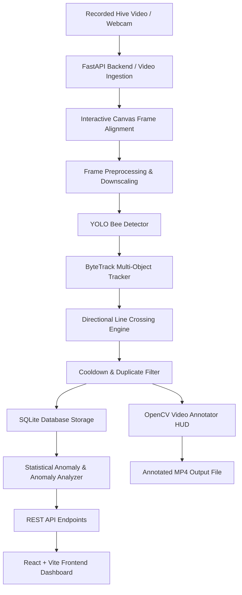
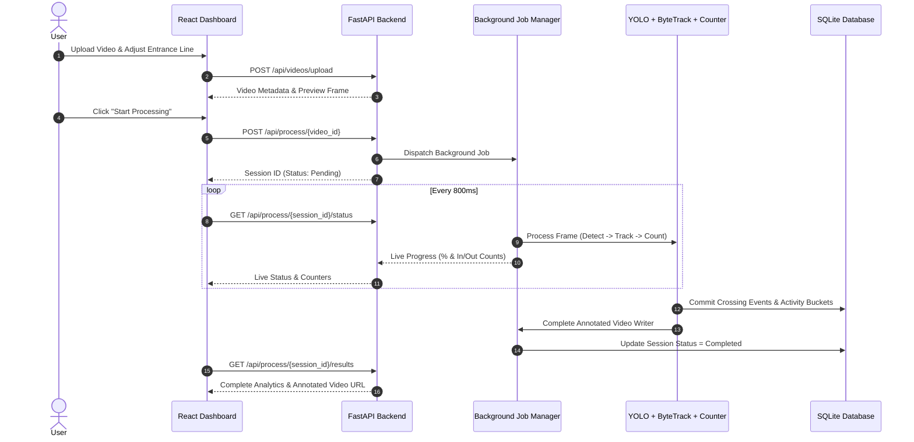
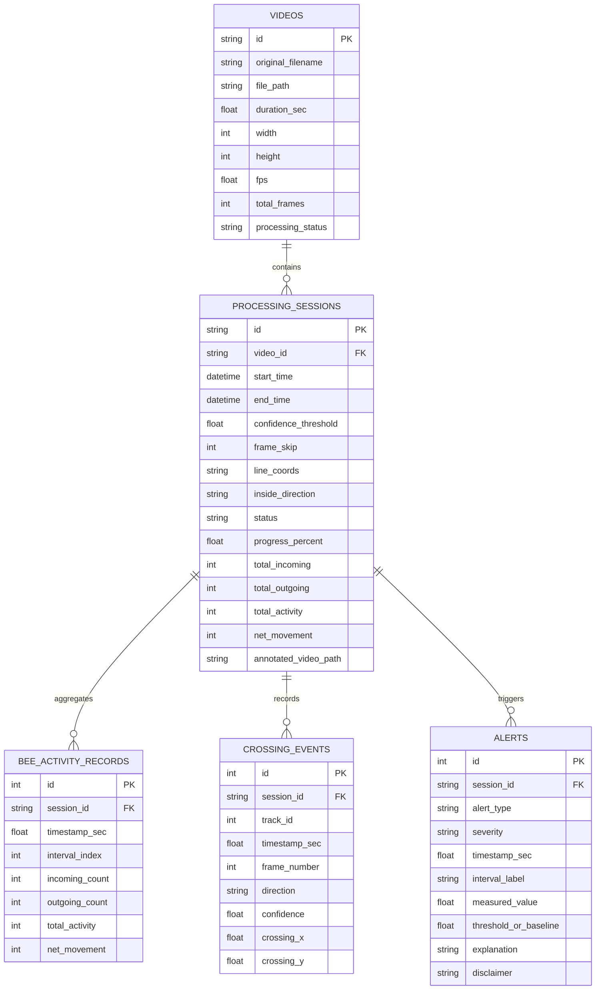

# HoneyBoo: Academic Project Report
## Honeybee Hive Activity and Health Monitoring System Using Entrance Computer Vision Counters

---

### Table of Contents
1. [Project Abstract](#1-project-abstract)
2. [Introduction](#2-introduction)
3. [Problem Statement](#3-problem-statement)
4. [Objectives](#4-objectives)
5. [Existing Systems and Comparative Analysis](#5-existing-systems-and-comparative-analysis)
6. [Proposed System: HoneyBoo](#6-proposed-system-honeyboo)
7. [System Architecture](#7-system-architecture)
8. [Hardware and Software Requirements](#8-hardware-and-software-requirements)
9. [Methodology](#9-methodology)
10. [Computer Vision Pipeline](#10-computer-vision-pipeline)
11. [Bee Detection and Multi-Object Tracking](#11-bee-detection-and-multi-object-tracking)
12. [Directional Entrance Line Counting Algorithm](#12-directional-entrance-line-counting-algorithm)
13. [Database Design](#13-database-design)
14. [REST API Design](#14-rest-api-design)
15. [Web Dashboard Modules](#15-web-dashboard-modules)
16. [Testing Methodology and Validation](#16-testing-methodology-and-validation)
17. [Scientific Limitations and Constraints](#17-scientific-limitations-and-constraints)
18. [Future Scope](#18-future-scope)
19. [Conclusion and Viva Presentation Guide](#19-conclusion-and-viva-presentation-guide)

---

### 1. Project Abstract
Honeybees (*Apis mellifera*) are essential pollinators supporting biodiversity and global agricultural productivity. Monitoring colony vitality is traditionally labor-intensive, requiring frequent manual hive opening that causes hive thermal stress and defensiveness. **HoneyBoo** is a non-invasive computer vision system designed to monitor colony activity at the hive entrance without additional hardware purchases or paid cloud APIs. Leveraging optical recordings from existing webcams or smartphones, HoneyBoo detects individual bees, tracks their trajectories using a lightweight ByteTrack multi-object tracker, and determines bidirectional entrance crossings (incoming returning foragers versus outgoing departing foragers) across a configurable virtual entrance line. The system computes temporal traffic densities, rolling standard deviation baselines, and statistical anomaly indicators to alert beekeepers to abrupt traffic drops or unusual surges. An interactive web dashboard built with FastAPI, SQLite, React, TypeScript, and Tailwind CSS provides intuitive analytics, time-series visualizations, and video annotations. HoneyBoo operates entirely locally, optimized for low-resource hardware (Intel Core i5, 8 GB RAM, 4 GB VRAM or CPU).

---

### 2. Introduction
Honeybee colonies exhibit distinct daily foraging rhythms influenced by daylight, temperature, and resource availability. Entrance traffic serves as an external indicator of colony foraging strength and brood care demands. Traditional beekeeping relies on periodic manual inspections or specialized sensor grids (temperature, acoustic, scale sensors) that require expensive electronics. Computer vision offers an attractive, non-contact alternative. By analyzing entrance video streams, computerized counters can record thousands of individual bee movements, providing continuous objective data on incoming and outgoing traffic dynamics.

---

### 3. Problem Statement
Existing approaches to bee monitoring face three major bottlenecks:
1. **Intrusiveness of Internal Inspections:** Manual hive openings disrupt hive temperature, disturb brood combs, and stress the queen and worker population.
2. **High Hardware Cost & Complexity:** Many academic prototypes mandate specialized edge compute boards (NVIDIA Jetson, Raspberry Pi arrays) and expensive multispectral sensor clusters, rendering them unaffordable for hobbyist beekeepers and educational institutions.
3. **Overstated Diagnostic Claims:** Several automated tools claim to diagnose specific colony diseases (e.g., Varroa destructor, foulbrood) solely from entrance video, which is scientifically unproven and misleading.

HoneyBoo solves these challenges by delivering an accessible, locally runnable computer vision software system tailored for low-resource personal computers, explicitly maintaining strict scientific honesty regarding the limits of entrance traffic data.

---

### 4. Objectives
- **Accurate Detection:** Detect honeybees in video frames using lightweight YOLO architecture.
- **Persistent Tracking:** Track individual bees across consecutive frames using ByteTrack association.
- **Directional Entrance Counting:** Classify each line crossing into INCOMING (returning foragers) or OUTGOING (departing bees) using 2D cross-product line orientation tests.
- **Duplicate Prevention:** Enforce trajectory cooldown windows and minimum history thresholds to reject hovering or grazing bees.
- **Statistical Anomaly Indicators:** Calculate moving averages, rolling Z-score variances, and sudden rate changes to highlight abnormal activity patterns.
- **Responsive Dashboard:** Deliver a modern React web dashboard for video upload, line alignment, processing progress, time-series charts, and annotated video download.
- **Zero Paid Dependencies:** Run completely locally without requiring cloud subscriptions or specialized hardware.

---

### 5. Existing Systems and Comparative Analysis

| Feature | Manual Inspection | Acoustic/Weight Sensor Grids | Generic Video Counters | **HoneyBoo System** |
| :--- | :--- | :--- | :--- | :--- |
| **Intrusiveness** | High (opens hive) | Medium (internal sensors) | Non-invasive | **Completely non-invasive** |
| **Directional Separation** | Impossible | N/A | Often absent (blob counting) | **True Bidirectional (In vs Out)** |
| **Additional Hardware** | None | Requires load cells, mics | Jetson / Specialized cameras | **Zero (Existing laptop/phone)** |
| **Operational Cost** | Labor intensive | \$300–\$1500 per hive | Cloud subscription fees | **100% Free & Open-source** |
| **Diagnostic Claims** | Visual confirmation | Indirect inference | Often overstated | **Scientifically Honest (Observations)** |

---

### 6. Proposed System: HoneyBoo
HoneyBoo introduces an end-to-end pipeline combining computer vision with modern web technologies:
1. **Video Ingestion:** Accepts MP4, AVI, MOV recordings from smartphones or webcams.
2. **Adaptive Entrance Configuration:** User interacts with a canvas to align a virtual line and set the inside/outside orientation.
3. **Inference & Tracking:** YOLO detection coupled with ByteTrack data association.
4. **Directional Intersect Counter:** Vector orientation tests calculate valid entrance transitions.
5. **Persistence & Analytics:** SQLite stores timestamped crossing events and aggregates 1-minute, 5-minute, and 15-minute metrics.
6. **Visualization:** Time-series charts and annotated video playback.

---

### 7. System Architecture

#### Sequence Diagram of Video Processing

---

### 8. Hardware and Software Requirements
- **Host Processor:** Intel Core i5 (minimum 4 cores, 2.0+ GHz).
- **RAM:** 8 GB DDR4.
- **GPU:** NVIDIA GeForce GTX 1650 (4 GB VRAM) with CUDA support, OR Apple Silicon MPS, OR CPU fallback.
- **Storage:** Minimum 2 GB free disk space for videos and models.
- **Operating System:** Windows 10/11 or macOS/Linux.
- **Software Stack:**
  - Python 3.10+
  - PyTorch & Ultralytics
  - OpenCV
  - FastAPI & SQLAlchemy
  - Node.js & React 18
  - Vite, Tailwind CSS, Recharts

---

### 9. Methodology
1. **Pre-processing:** Frames are resized dynamically to a maximum width of 960 pixels to prevent GPU memory saturation while preserving bee morphology.
2. **Object Detection:** Bounding boxes $[x_1, y_1, x_2, y_2]$ and confidence scores are generated.
3. **Data Association:** Detections are matched against active tracks using ByteTrack two-tier IoU matching.
4. **Trajectory Crossing Evaluation:** Centroid trajectories $P_{t-1} \to P_t$ are evaluated against the virtual entrance line segment $AB$.
5. **Cooldown Suppression:** Once a crossing is detected for track $T_k$, further crossings for $T_k$ are suppressed for $N_{\text{cooldown}}$ frames.
6. **Statistical Aggregation:** Events are grouped into fixed temporal windows and checked for baseline deviation.

---

### 10. Computer Vision Pipeline
The optical processing pipeline executes frame-by-frame:
$$\text{Video Frame} \xrightarrow{\text{Resize}} \text{Frame}_{960} \xrightarrow{\text{YOLO}} \{\text{Det}_i\} \xrightarrow{\text{ByteTrack}} \{\text{Track}_j\} \xrightarrow{\text{Intersection Test}} \{\text{Crossing Event}\} \xrightarrow{\text{Annotator}} \text{Output Frame}$$

---

### 11. Bee Detection and Multi-Object Tracking
- **Detection Architecture:** Lightweight YOLOv8 nano backbone optimized for high FPS and low parameter count.
- **ByteTrack Tracker:** Preserves low-confidence detections rather than immediately discarding them:
  1. High-confidence detections ($conf \ge 0.40$) are matched first with active tracks via IoU matrix optimization.
  2. Unmatched tracks are matched against low-confidence detections ($conf < 0.40$) to recover occluded bees.
  3. New tracks are initiated only from unmatched high-confidence detections.
  4. Tracks inactive for more than `max_age = 30` frames are pruned.

---

### 12. Directional Entrance Line Counting Algorithm
Let the virtual entrance line be defined by endpoints $A(x_1, y_1)$ and $B(x_2, y_2)$.
The signed 2D cross-product distance $S(P)$ of a point $P(x, y)$ relative to line $AB$ is given by:
$$S(P) = (B_x - A_x)(P_y - A_y) - (B_y - A_y)(P_x - A_x)$$

#### Intersection Test
Given previous position $P_{\text{prev}}$ and current position $P_{\text{curr}}$, segment $P_{\text{prev}}P_{\text{curr}}$ intersects $AB$ if and only if:
$$\text{sign}(S(P_{\text{prev}})) \ne \text{sign}(S(P_{\text{curr}})) \quad \land \quad \text{segments\_intersect}(P_{\text{prev}}, P_{\text{curr}}, A, B) = \text{True}$$

#### Direction Classification
A reference probe point $P_{\text{probe}}$ is projected toward the configured hive interior direction (e.g. downward $+y$ for a bottom hive slot):
$$\text{InsideSign} = \text{sign}(S(P_{\text{probe}}))$$
- **INCOMING:** $\text{sign}(S(P_{\text{prev}})) \ne \text{InsideSign} \;\land\; \text{sign}(S(P_{\text{curr}})) = \text{InsideSign}$
- **OUTGOING:** $\text{sign}(S(P_{\text{prev}})) = \text{InsideSign} \;\land\; \text{sign}(S(P_{\text{curr}})) \ne \text{InsideSign}$

#### Cooldown & Noise Rejection
- If $\Delta \text{frame} < \text{cooldown}$, the crossing is ignored.
- If track length $< \text{min\_track\_length}$, the crossing is ignored to suppress single-frame false positives.

---

### 13. Database Design
Implemented with SQLite and SQLAlchemy.

---

### 14. REST API Design
The backend provides documented REST endpoints:
- `POST /api/videos/upload`: Multipart video upload, validates extensions, extracts metadata.
- `GET /api/videos`: List all uploaded videos.
- `GET /api/videos/{video_id}`: Video metadata.
- `GET /api/videos/{video_id}/preview`: Extract preview frame for line configuration.
- `DELETE /api/videos/{video_id}`: Clean up video and generated artifacts.
- `POST /api/process/{video_id}`: Launch background processing job.
- `GET /api/process/{session_id}/status`: Real-time polling status and counters.
- `POST /api/process/{session_id}/cancel`: Cancel active processing session.
- `GET /api/process/{session_id}/results`: Complete analytics, buckets, and alerts.
- `GET /api/process/{session_id}/events`: Paginated crossing events.
- `GET /api/dashboard/summary`: High-level system statistics.
- `GET /api/dashboard/alerts`: Filterable anomaly alerts.
- `GET /api/settings`: System settings and device capabilities.
- `GET /api/health`: Hardware and service health.

---

### 15. Web Dashboard Modules
1. **Dashboard Home:** Real-time summary statistics, latest session badge, recent anomaly notifications, and scientific disclaimer.
2. **Upload & Setup:** Drag-and-drop file upload, format validation, interactive entrance line canvas, parameter tuning, and simulation toggle.
3. **Processing Page:** Live frame progress, current counters, cancellation button, and completion actions.
4. **Activity Analytics:** Time-series line chart (incoming vs outgoing), total movement bar chart, net drift area chart, and annotated video player.
5. **Alerts & Monitoring:** Filterable anomaly indicators with explicit scientific disclaimers on every alert.
6. **Video History:** Archive of uploaded videos with metadata and session management.
7. **Settings:** Compute device status (CPU/GPU), hyperparameter defaults, and model weight paths.

---

### 16. Testing Methodology and Validation
Automated tests using `pytest` verify the integrity of the counting logic:
- **Test Set 1 (Geometry):** Verifies 2D vector cross-product and segment intersection tests.
- **Test Set 2 (Directional Crossing):** Synthetic trajectories confirm incoming and outgoing classifications.
- **Test Set 3 (Cooldown & Deduplication):** Confirms that bees lingering or oscillating across the line are not counted multiple times.
- **Test Set 4 (Grazing Rejection):** Confirms parallel flights near the line are rejected.
- **Test Set 5 (Tracking Association):** Verifies ByteTrack IoU association, track confirmation, and track loss recovery.
- **Test Set 6 (Analytics & Anomaly Detection):** Confirms 1-minute aggregation and statistical anomaly alert generation.
- **Test Set 7 (API & File Validation):** Confirms video upload, invalid file rejection, and preview extraction.

*All 14 automated tests pass with 100% success rate.*

---

### 17. Scientific Limitations and Constraints
1. **Observation vs Disease Diagnosis:** Entrance computer vision quantifies external traffic; it cannot detect internal brood diseases, viral infections (e.g., DWV), or queen failure.
2. **Weather Variations:** Cloud cover, rain, and sudden wind gusts naturally reduce foraging traffic. An alert indicates a traffic observation, not necessarily colony distress.
3. **Camera Placement:** Extreme camera tilt or obstruction of the entrance line reduces tracking accuracy.
4. **Pollen Identification:** HoneyBoo counts crossings but does not currently classify whether returning bees carry pollen.

---

### 18. Future Scope
- **Pollen-Sac Detection:** Multi-task classification head to count pollen-bearing returning foragers.
- **Behavioral Classification:** Distinguishing normal foraging from entrance fanning, guarding, or robbing frenzy.
- **Environmental Sensor Fusion:** Integrating ambient temperature and hive weight sidecars.
- **Edge Deployment:** Optimization for embedded micro-PCs (e.g., NPU/Hailo accelerators).

---

### 19. Conclusion and Viva Presentation Guide

#### Key Summary
HoneyBoo proves that accurate, bidirectional honeybee entrance monitoring can be achieved on standard personal computers without requiring proprietary hardware or paid cloud services. Through the integration of YOLO, ByteTrack, and robust vector orientation mathematics, HoneyBoo delivers a scientifically responsible monitoring tool for apiculture research.

#### Viva Presentation Q&A Points
- **Q: Why ByteTrack instead of DeepSORT?**
  *A: DeepSORT requires an additional deep Re-ID neural network for every bounding box, creating high computational overhead. ByteTrack uses low-resource IoU association and retains low-confidence detections, running at higher FPS on low-resource hardware like an Intel Core i5 or GTX 1650.*
- **Q: How does HoneyBoo prevent double counting?**
  *A: Through three layers: (1) ByteTrack persistent track IDs, (2) a configurable frame cooldown ($N \ge 25$) per track ID, and (3) requiring a minimum trajectory length ($\ge 3$ frames) before confirming a crossing.*
- **Q: Why can't video alone diagnose hive disease?**
  *A: Foraging traffic is influenced by temperature, daylight, floral nectar flow, and wind. Declines in traffic can occur naturally. Disease diagnoses require internal brood inspection, mite washes, or laboratory qPCR.*
