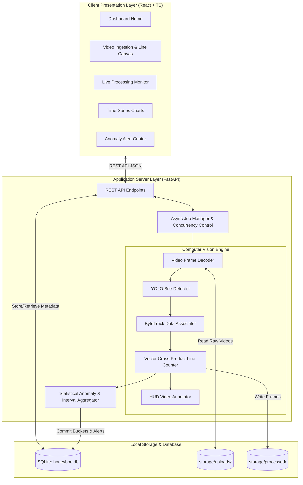

# HoneyBoo: Technical Architecture Documentation

This document describes the software architecture, computer vision algorithms, and backend/frontend subsystem interactions of the HoneyBoo monitoring system.

---

## 1. High-Level Architecture Overview

HoneyBoo uses a decoupled client-server architecture:
- **Presentation Layer (Frontend):** Built with React 18, TypeScript, Vite, Tailwind CSS, and Recharts. Connects to backend REST endpoints via Axios with an active polling loop during video inference.
- **Application & Computer Vision Layer (Backend):** Built with Python FastAPI, OpenCV, PyTorch, and Ultralytics YOLO. Runs CPU/GPU-bound tasks in a background thread executor.
- **Persistence Layer (Database & Storage):** SQLite database managed via SQLAlchemy ORM, alongside structured local file storage (`storage/uploads/` and `storage/processed/`).

---

## 2. Computer Vision Subsystem

### 2.1 Low-Resource Hardware Optimization
To operate reliably on an Intel Core i5 with 8 GB RAM and an NVIDIA GTX 1650 (4 GB VRAM):
1. **Dynamic Frame Downscaling:** Video frames exceeding width 960 are proportionally downscaled:
   $$\text{scale} = \frac{960}{W_{\text{orig}}}, \quad H_{\text{target}} = \lfloor H_{\text{orig}} \cdot \text{scale} \rfloor$$
2. **Frame Skipping Decoupling:** When `frame_skip > 1`, intermediate frames are bypassed, and track velocities are adjusted accordingly.
3. **Sequential Stream Processing:** Frames are read sequentially via OpenCV `cv2.VideoCapture` and released immediately after annotation. Entire video files are never loaded into memory.

### 2.2 Directional Line Crossing Logic
The virtual entrance line is defined by two normalized points $P_1(x_1, y_1)$ and $P_2(x_2, y_2)$ mapped to pixel space.
Given bee positions $P_{t-1}$ and $P_t$:
1. **2D Segment Intersection:**
   Orientation cross product:
   $$ccw(A, B, C) = (B_x - A_x)(C_y - A_y) - (B_y - A_y)(C_x - A_x)$$
   Segments $AB$ and $CD$ intersect if $\text{sign}(ccw(A, B, C)) \ne \text{sign}(ccw(A, B, D))$ and $\text{sign}(ccw(C, D, A)) \ne \text{sign}(ccw(C, D, B))$.
2. **Side Classification:**
   The signed distance:
   $$S(P) = (B_x - A_x)(P_y - A_y) - (B_y - A_y)(P_x - A_x)$$
   determines whether point $P$ is on the Inside or Outside side of line $AB$.
3. **Direction Determination:**
   - Outside $\to$ Inside: **INCOMING**
   - Inside $\to$ Outside: **OUTGOING**
4. **Duplicate Prevention:**
   Each track ID maintains a `last_crossing_frame`. If $(f_{\text{curr}} - f_{\text{last}}) < \text{cooldown}$, the crossing is ignored.
   Minimum track trajectory history length must be $\ge 3$ points to filter single-frame noise.

---

## 3. Asynchronous Job Manager
Video processing is handled by `VideoJobManager`:
- Executes in a background thread via `asyncio.get_event_loop().run_in_executor()`.
- Thread-safe tracking of current frame, total frames, incoming count, and outgoing count.
- Provides non-blocking API polling responses (`/api/process/{session_id}/status`) every 800ms.
- Supports graceful cooperative cancellation via `job_manager.cancel_job(session_id)`.

---

## 4. Anomaly Detection Engine
Aggregates activity records into temporal intervals (60s, 300s, 900s).
- **Z-Score Anomaly:**
  Calculates rolling mean $\mu$ and standard deviation $\sigma$ from preceding windows:
  $$Z = \frac{x_t - \mu}{\sigma}$$
  If $Z \ge 2.0$, triggers `HIGH_ACTIVITY`. If $Z \le -2.0$, triggers `LOW_ACTIVITY`.
- **Sudden Drop Ratio:**
  $$\Delta = \frac{x_{t-1} - x_t}{x_{t-1}}$$
  If $\Delta \ge 0.60$ (60% drop), triggers `SUDDEN_DROP`.
- **Disclaimer Enforcement:**
  All generated alerts automatically attach the mandatory scientific limitation statement.
